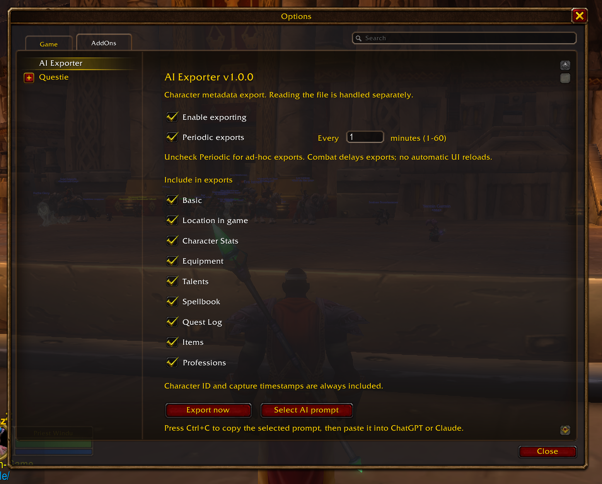
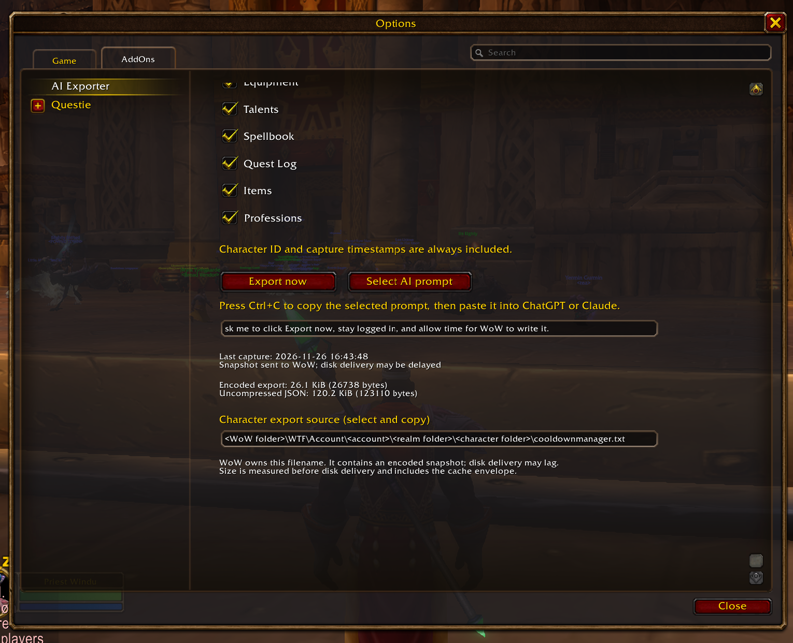

# WoW Forever AI Exporter

The WoW Forever AI Exporter lets you export your character’s data to a cache file managed by WoW. You can then Alt+Tab to a desktop AI client, such as ChatGPT or Claude, or keep it open alongside WoW to ask questions using regularly updated information about your character.

Some addons provide an in-game AI chat interface that requires an API key. WoW Forever AI Exporter works with your desktop AI client and does not require an API key. The addon includes a PowerShell decoder to extract your character’s data from the cache file, and the data is formatted for efficient AI token usage. Other addons require you to copy and paste data between your game and your AI client. This addon automates that process.

After installing the addon, open its settings to choose which data categories to export and how often to export them. The default settings—automatic exports every minute with all categories enabled—are a good starting point. Enter `/exporter` to open the settings, or `/exporter now` to export manually.

The addon provides a prompt you can select, copy, and paste into your desktop AI client. If the client can access your local files and run PowerShell commands, it can use the included decoder to read your character’s data and answer questions about it.

If you experience disruptive stuttering during exports, increase the interval between exports or switch to manual exports.

If you disconnect immediately after an export, the export may be too large for WoW’s cache to handle. Try reducing the number of enabled data categories. The author observed disconnects with exports of approximately 40,000 bytes.





## 1. Install the addon

Already installed? Skip to [Open the settings](#2-open-the-settings).

You need WoW Forever on Windows and the **Exporter** folder from the release
ZIP or project source. The snapshot decoder runs with Windows PowerShell 5.1,
which comes with Windows.

1. Close WoW completely.
2. Open this project's folder. If you downloaded a ZIP file, right-click it,
   choose **Extract All**, and open the extracted folder first.
3. Copy the folder named **Exporter**. In a release ZIP it is at the top level.
   In the project source it is inside **addon**.
4. Open the folder containing your WoW Forever game files, usually called
   **_forever_**. Inside it, open **Interface**, then **AddOns**.
5. Paste **Exporter** into **AddOns**. If updating an existing copy, first copy
   the old Exporter folder somewhere outside AddOns as a backup, then replace
   its files with the new ones.
6. Start WoW. On the character selection screen, open **AddOns** and make sure
   **AI Exporter** is checked. Then log into your character.

Check that the files are arranged like this:

```text
_forever_
  Interface
    AddOns
      Exporter
        Exporter.toc
        Exporter.lua
        Decode-Export.ps1
        ExportWire.cs
        ...other addon files
```

`Exporter.toc`, `Decode-Export.ps1` and its helper `ExportWire.cs` should sit
together directly inside `Interface\AddOns\Exporter`.

## 2. Open the settings

While playing, press **Enter**, type `/exporter`, and press **Enter** again.
You can also open **Settings → AddOns → AI Exporter**.

- **Enable exporting** turns character exports on or off.
- **Periodic exports** starts on. By default, the addon attempts an export shortly
  after login and every **1 minute** afterward, subject to the delays described
  below. You can choose any whole number from 1 to 60 minutes. This interval
  schedules attempts; it does not guarantee when the file updates.
- **Export now** requests a new snapshot. Scroll down if you cannot see it.

For manual use, uncheck **Periodic exports** and click **Export now** whenever
you want a fresh snapshot. While exporting is enabled, changing settings also
queues one export so your new choices take effect. WoW remembers your settings
between sessions.

## 3. Choose what to include

All nine categories start checked. Uncheck anything you do not want in future
exports.

| Setting | What it includes |
| --- | --- |
| **Basic** | Name, level, class, race, faction, money, and experience progress. |
| **Location in game** | Your zone and position on the map. |
| **Character Stats** | Maximum health and mana, attributes such as intellect, and combat stats. |
| **Equipment** | What you are wearing, including weapons, enchants, and gems. |
| **Talents** | Your active talent build and the choices in its visible talent trees. |
| **Spellbook** | Spells you have learned, including their ranks and descriptions. |
| **Quest Log** | Current quests, objectives, progress, rewards, and completed quest history. |
| **Items** | Items and quantities in the bags you are carrying. |
| **Professions** | Your professions and skill levels, including cooking, first aid, and fishing. |

The addon only includes information it can read from the game. Some details
may appear in a later export after the game finishes loading them. Bank contents,
mail, profession recipes, and full quest story text are not included.

Every snapshot includes a character ID and the time it was captured. Turning off
**Basic** removes your name and other Basic details from the next snapshot, but
it does not remove that ID or change copies you already saved or shared.

## 4. Make an export

1. Finish combat and stop changing your action bars.
2. Open `/exporter` and check that **Enable exporting** is on.
3. Click **Export now**.
4. Look below the button for **Last capture** and the status message. A successful
   attempt says **"Snapshot sent to WoW; disk delivery may be delayed."**

**Queued** means the addon is waiting. It leaves at least 30 seconds between
export attempts and also waits during combat or action-bar changes.

WoW decides when to update the file on your computer, so a successful capture
may not be available in the file immediately. The size numbers below the status
show how much data was prepared; they do not confirm that the file has updated.

## 5. Share it with an AI

Open `/exporter`, click **Select AI prompt**, press **Ctrl+C**, and paste into
ChatGPT or Claude. An AI client with permission to read files and run PowerShell
on your Windows PC can run the included decoder and read your character's
snapshot. Pasting the prompt does not grant those permissions. If the prompt
needs your game folder, provide the folder containing **Interface** and **WTF**,
usually called **_forever_**.

If your AI client cannot run commands on your PC, run the command in the prompt
yourself with `-Output` and a destination filename to save a JSON file, then
attach that file to your chat.
[Step-by-step sharing instructions](docs/SHARING_WITH_AI.md)

**Check freshness before using the data.** Confirm the character ID
(`character.guid`) and decoded capture time (`capturedAt`), including its time
zone. The decoder reads an existing snapshot; it does not request a new export
or check whether the data is current. The AI prompt asks the AI to choose the
newest matching snapshot and flag stale data. Some sections, such as a retained
talent build during uncommitted edits, can have an older capture time of their
own. Successful decoding does not mean every observation is fresh. If the data
is stale, click **Export now**, stay logged in, allow time for WoW to write it,
and run the decoder again.

**Keep your character logged in while converting the file.** Logging out,
reloading, or disabling exporting can remove the snapshot from the game file.
The converted `.json` copy stays available after you leave the game.

## In-game commands

Press **Enter** in WoW, type a command below, and press **Enter** again.
These are in-game chat commands.

| Command | What it does |
| --- | --- |
| `/exporter` | Opens the AI Exporter settings. |
| `/exporter now` | Requests an export and prints its status. Exporting must be enabled. Also retries after an export failure. |
| `/exporter status` | Prints the addon version and current export status in chat. |
| `/exporter path` | Prints the character export source path or paths. If no local path is configured, shows a template path with placeholders. |
| `/exporter on` | Enables exporting and queues an export using your saved settings. |
| `/exporter off` | Disables exporting and cancels any pending export. Previously saved files may still contain earlier snapshots. |

`/exporter now` follows the same combat, action-bar, and 30-second minimum
interval rules as **Export now**. WoW may delay writing the snapshot to disk.
Turning exporting on or off preserves your periodic export and category settings.
To change the interval, periodic exports, or included categories, use `/exporter`
to open the settings.

## If something goes wrong

| Problem | What to do |
| --- | --- |
| The addon is missing, or `/exporter` does nothing. | Check the folder layout above, fully restart WoW, and enable the addon in the AddOns menu. |
| It says an export is queued. | Leave combat, finish action-bar changes, and allow at least 30 seconds since the previous attempt. |
| It says an export failed. | Read the error. Automatic attempts pause after a failure. Address the reported problem, then use **Export now** to retry. |
| It says the export is too large. | Uncheck categories you do not need. The last successful snapshot is kept until a new one succeeds. |
| The file is missing, old, or cannot be converted. | See the [file-sharing help](docs/SHARING_WITH_AI.md#if-something-goes-wrong). |
| WoW disconnects during exporting. | Disable **AI Exporter** in the AddOns menu before logging back in. Keep the error message when reporting the problem. |

## More details, if you need them

- [Sharing a file with an AI](docs/SHARING_WITH_AI.md) — step-by-step instructions.
- [Detailed information collected](docs/COLLECTION_DETAILS.md) — category limits and file locations.
- [Developer guide](docs/DEVELOPMENT.md) — scripted installation, building, and testing.
- [Export format](EXPORT_FORMAT.md) — for people writing software that reads the data.

Current version: **1.0.0**. Licensed under the [MIT License](LICENSE); see
[third-party notices](THIRD_PARTY.md).
